# StompMod

Custom firmware for the Line 6 HX Stomp 3.80.0, built in your browser from your own copy of Line 6's firmware.

**Build it at [gatistudio.com/stompmod](https://gatistudio.com/stompmod).** Version 1.1.0, free.

StompMod is a fork of [hxtra](https://github.com/wisemandenny/hxtra) by wisemandenny, under the same licence (GPL-3.0-or-later, see [LICENSE](LICENSE) and [NOTICE](NOTICE)). It keeps hxtra's features and adds the ones listed under [What StompMod adds](#what-stompmod-adds). No Line 6 firmware or HX Edit files are in this repository.

<a href="https://gatistudio.com/stompmod">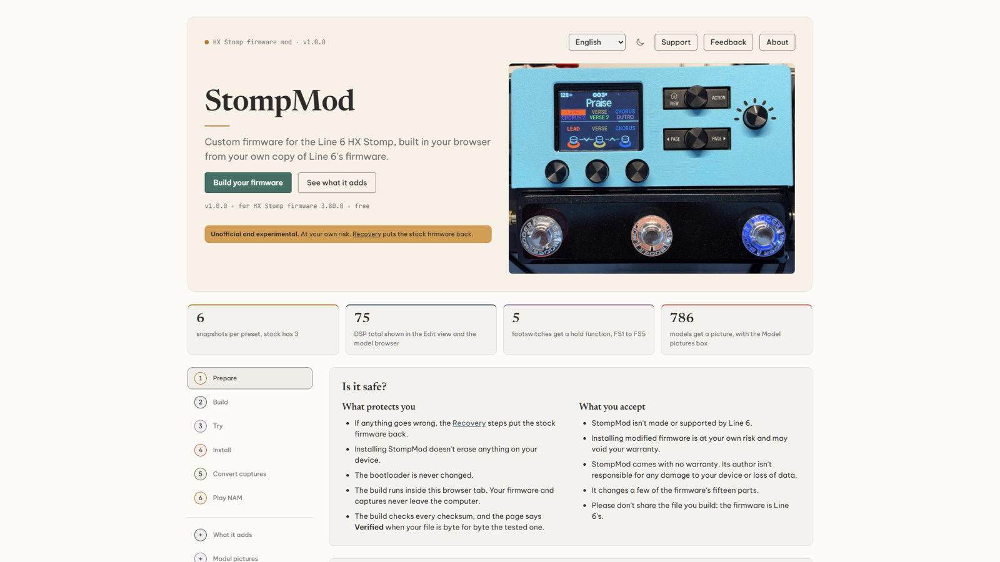</a>

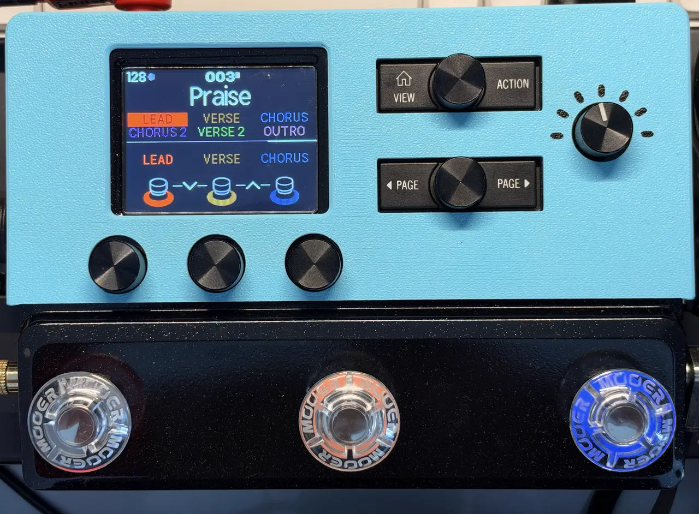

> **Unofficial and experimental.** StompMod isn't made or supported by Line 6. Installing modified firmware is at your own risk and may void your warranty, and StompMod comes with no warranty. The bootloader is never changed, so the [recovery steps](https://gatistudio.com/stompmod/#recovery) always put the stock firmware back.

## How it works

1. Back up your presets in HX Edit and download the stock HX Stomp 3.80.0 firmware from Line 6.
2. Open [the page](https://gatistudio.com/stompmod), pick that file and build. The build runs in the browser tab: your firmware never leaves the computer. It checks every checksum and compares the result with the tested build, and says Verified when they match byte for byte.
3. Install the built file with Line 6 Updater, as you would a stock update.

## What StompMod adds

These are not in hxtra (compared with hxtra's main branch on 25 November 2026).

### Model pictures

A picture of the selected model in the Edit view, and of the model under the cursor in the model browser. They are HX Edit's own pictures: the page reads them from the HX Edit installed on your computer when you tick the Model pictures box, so none is in this repository and nothing is uploaded. 786 models get a picture. NAM A2 Lite has its own, an original amp head drawn for this project ([assets/model_pictures/nam_a2_lite.png](assets/model_pictures/nam_a2_lite.png)).

<table>
<tr>
<td width="50%">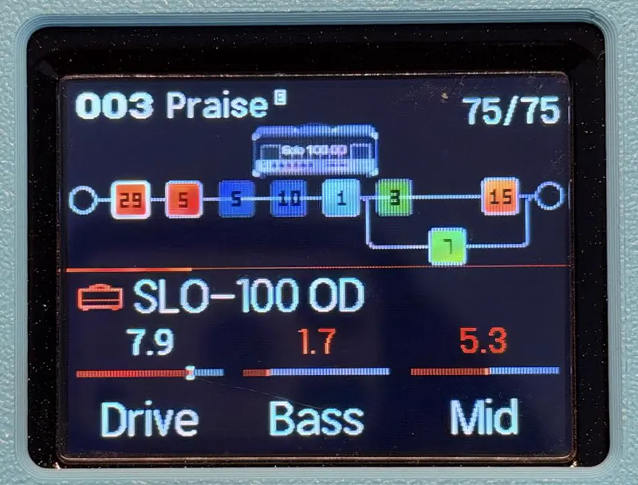</td>
<td width="50%">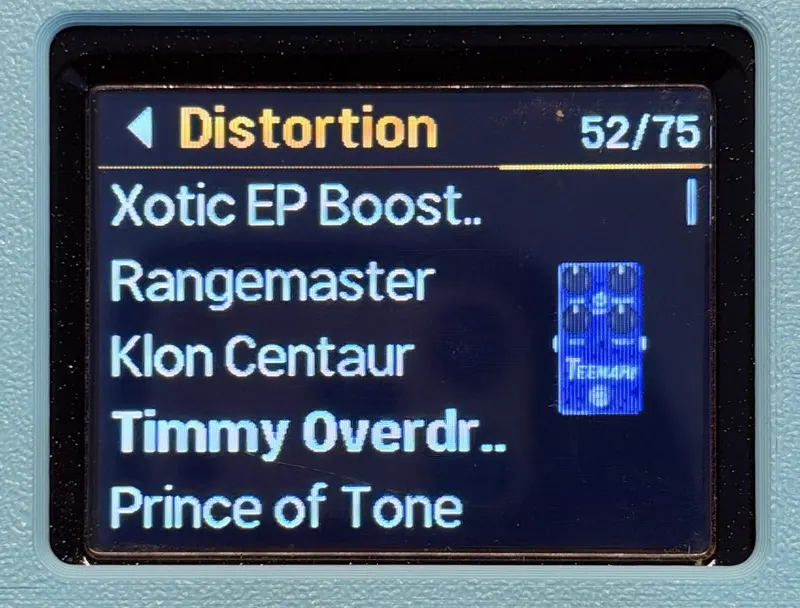</td>
</tr>
<tr><td>Edit view</td><td>Model browser</td></tr>
</table>

Settings: Global Settings > Displays > Model Pictures (on by default) and Browser Icons (off by default). With Browser Icons off, the lists below Category show no category icons, so the names start further left.

### Snapshot names on the Home screen

In Snapshot mode the top of the Home screen shows the names of all six snapshots in two rows, each in its snapshot's colour, with the one playing boxed. They also show in Scroll mode when its up and down switches are on snapshots. The preset number and name move up and get smaller to make room.

<table>
<tr>
<td width="33%">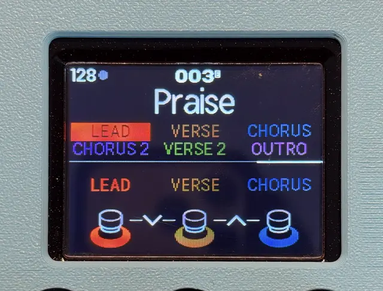</td>
<td width="33%">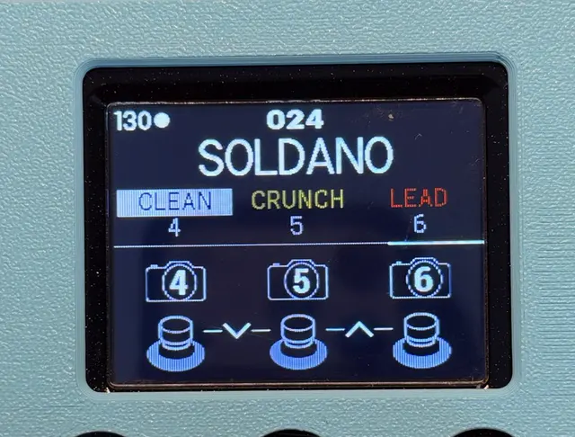</td>
<td width="33%">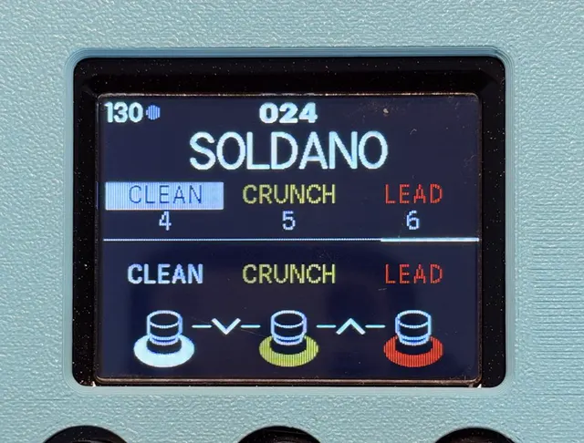</td>
</tr>
</table>

Setting: Global Settings > Displays > Snapshot Names (on by default).

### DSP display switches

hxtra shows the DSP each block uses. StompMod lets you turn each part on or off: Blocks DSP (the share on each block in the Edit view), Browser DSP (each model's share in the model browser) and Total DSP (the total at the top right). All three off turns the display off.

<table>
<tr>
<td width="50%">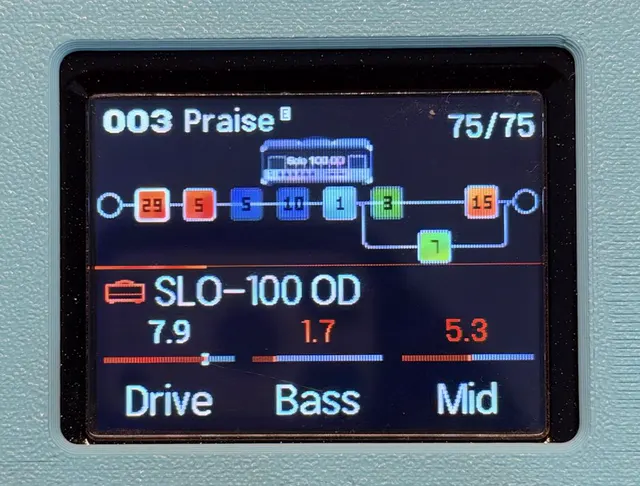</td>
<td width="50%">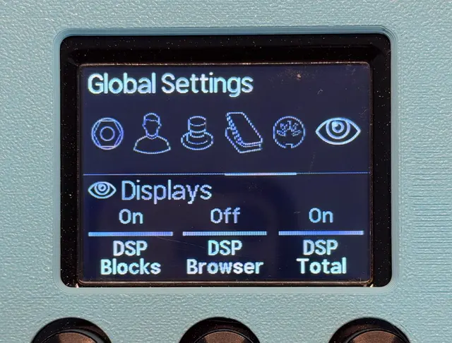</td>
</tr>
</table>

### BPM in Displays, with a beat dot after the tempo

The tempo display's settings (BPM Size, BPM Color, BPM Dot) live in Global Settings > Displays. The default dot is a small one right after the tempo, and the default size fits above the preset name next to the snapshot names.

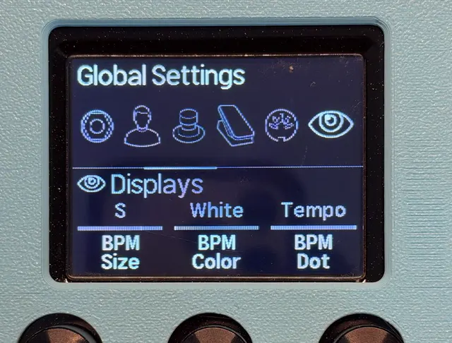

### Your own boot picture, from the page

hxtra sets a boot picture only from the command line. On the StompMod page you pick any picture, choose Fill or Fit, and see a preview at 320 x 240 that marks where the loading bar and the boot line fall. Without one, the boot screen shows StompMod's signal chain picture with the line "Made by GaTi". `HX_SPLASH_LINE=hide` hides the boot line in a command-line build.

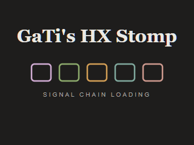

### Snapshot editor for Windows

StompMod Snapshots, a small Windows app, names and colours all six snapshots of the preset playing, snapshots 4 to 6 included,
which HX Edit does not show. Close HX Edit, open the app, press Send to HX Stomp, then save the preset on the unit. It needs
StompMod 1.1.0 or newer. Download it from the [releases](https://github.com/gati263/stompmod/releases/latest); it is not code
signed yet, so Windows SmartScreen may warn, and its source is [apps/snapshots/](apps/snapshots/).

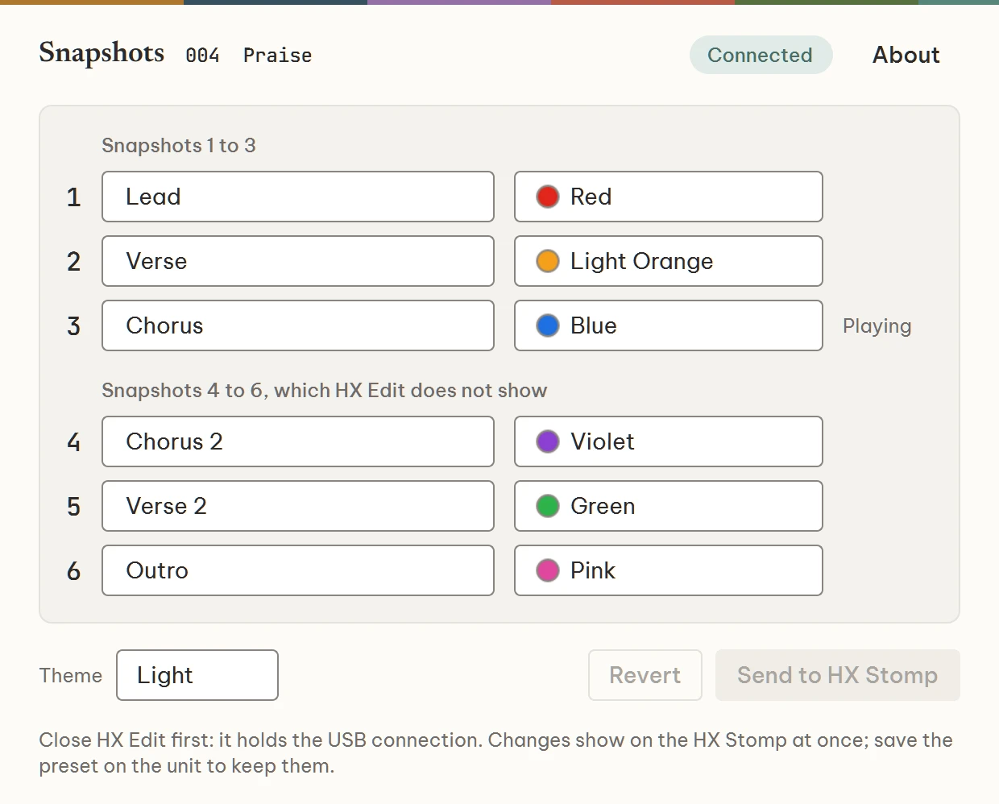

### The page

- Model pictures and your own boot picture, both built in the browser.
- English and Vietnamese.
- A feedback form, and a Report this problem button when a build fails.

## From hxtra

Everything hxtra's firmware adds is in StompMod too: six snapshots, the BPM display and tap colours, the DSP meter, real block names, long press and virtual footswitches, the Tap command, the breathing line, the metronome, the gain reduction meter, the tuner page and NAM A2 Lite. [docs/features.md](docs/features.md) describes each one, and [hxtra's README](https://github.com/wisemandenny/hxtra#readme) introduces them with videos.

<table>
<tr>
<td width="33%">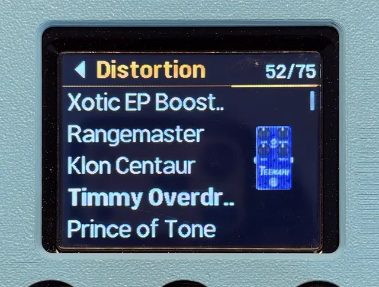</td>
<td width="33%">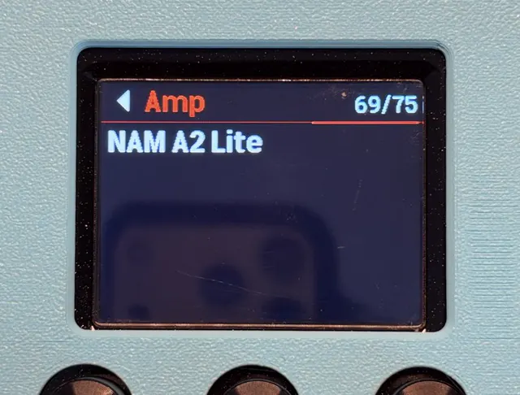</td>
<td width="33%">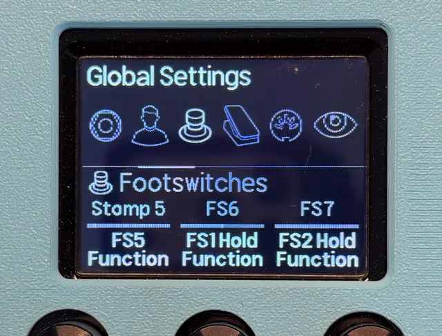</td>
</tr>
<tr><td>Real block names</td><td>NAM A2 Lite</td><td>Long press</td></tr>
</table>

## Building from source

The page is [web/](web/). [tools/build_site.py](tools/build_site.py) builds the site and [deploy/stompmod/](deploy/stompmod/) deploys it as a Cloudflare Worker. The command-line build is described in [docs/building.md](docs/building.md); it can leave out any feature and set the boot text. The tests run with `pytest`.

StompMod targets the HX Stomp. The HX Stomp XL and HX Effects builds come from hxtra and are not tested here.

## Contact

Gia Thinh (GaTi), contact@gatistudio.com. Bugs and ideas: the feedback form on [the page](https://gatistudio.com/stompmod), or an issue here.

## Licence

GPL-3.0-or-later, as hxtra. See [LICENSE](LICENSE) and [NOTICE](NOTICE), which also lists the third-party material. Line 6, Helix, HX Stomp, HX Effects and HX Edit are trademarks of Yamaha Guitar Group, Inc.; this project is not affiliated with or endorsed by them.
